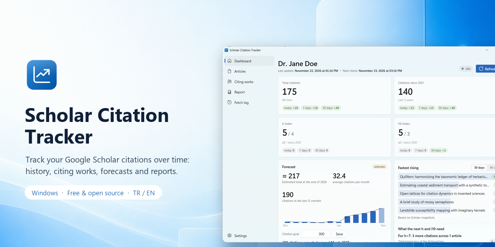
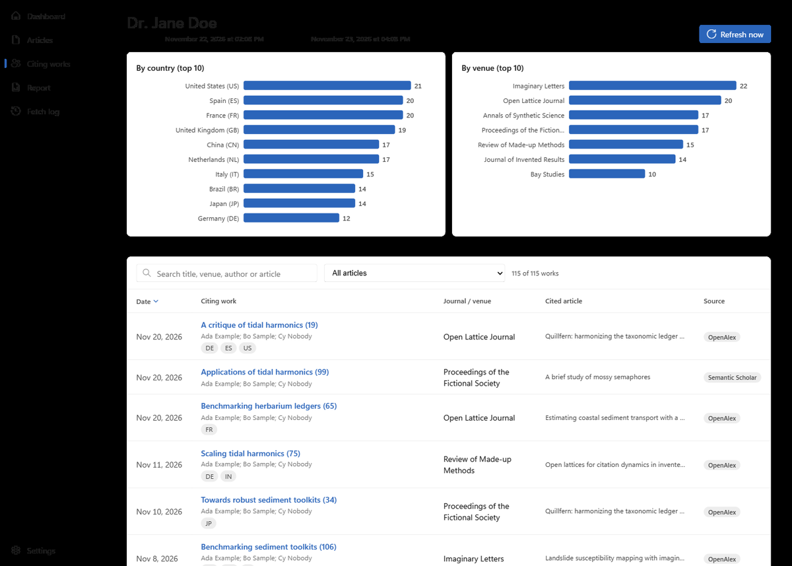
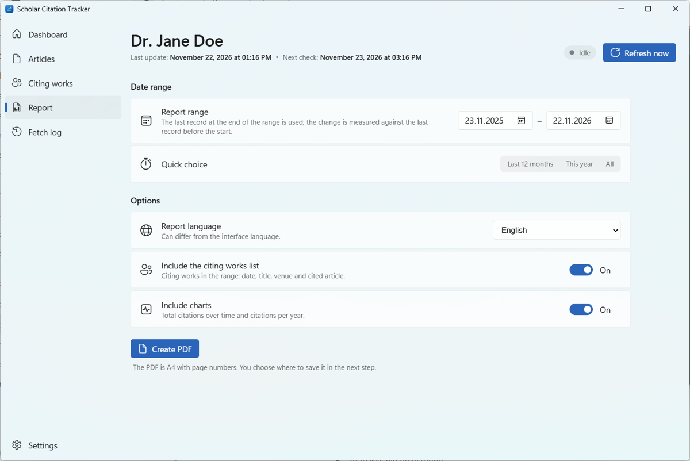

# Scholar Citation Tracker

<p align="center"></p>

<p align="center"><a href="https://github.com/bcankara/scholar-citation-tracker/releases/latest"><b>⬇ Download for Windows</b></a> · <a href="README.tr.md">Türkçe</a></p>

A small Windows desktop app (Rust + Tauri 2) that tracks the citation counts on a public Google Scholar profile over time. It is meant for personal use: you point it at your own profile, it checks the page at a low rate, and it keeps the history on your computer.

The interface is available in **English** and **Turkish**. On first launch the language follows the Windows display language; you can change it at any time in Settings.

## Screenshots

<table>
<tr><td width="50%"><br><sub>Dashboard: totals, one citation-history chart, recent citations, forecast and fastest rising articles</sub></td><td width="50%"><br><sub>Articles: per-article history, change history, matched record and citing works</sub></td></tr>
<tr><td width="50%"><br><sub>Citing works: by country and venue</sub></td><td width="50%"><br><sub>PDF citation report</sub></td></tr>
</table>

## What it does

- Reads the profile page at a fixed interval (default: every 3 hours, configurable from 1 to 24) and stores total citations, h-index, i10-index, per-article citations and the yearly citation histogram in a local SQLite database.
- The dashboard shows the change today / over 7 days / over 30 days, **one** citation-history chart (switch between the running **Total** and the new citations **Per period**, by day, month or year), a list of [recent citations](#recent-citations-and-scholars-cited-by-list), a forecast and the fastest-rising articles. The Articles tab lets you open the history of each article, including every change of its count, up or down.
- Shows a Windows notification when a citation count rises or a new article appears (the very first fetch is silent). Scholar sometimes removes citations (and may add them back later): decreases are shown in red in the tables and the change history, but never trigger a notification. If one check has both, the notification shows the net change and the articles that rose.
- Failed attempts are retried every 5 minutes, up to 3 more times; every attempt is listed in the Fetch log tab. If Google blocks the request (HTTP 429 / 403, CAPTCHA page), the attempt is recorded as "Blocked" and the app waits for the next cycle.
- Closing the window minimises the app to the notification area (tray). The tray menu has "Open dashboard", "Refresh now", "Open data folder" and "Quit".
- Optional start with Windows: the app then starts hidden, in the tray only. It is on by default but is only registered once you have entered a profile, and you can turn it off in Settings.
- The summary history and the article history can be exported as CSV (UTF-8 with BOM, so Excel shows non-ASCII characters correctly), or everything as one Excel workbook. Column headers follow the selected language.
- Nothing is fetched until you enter a profile. The first-run card accepts either a bare profile ID or the full profile URL (`https://scholar.google.com/citations?user=XXXX&hl=en`), together with your ORCID iD (required, see [Historical data](#historical-data-optional)).
- Changing the profile later deletes the stored data of the previous profile, after a confirmation.
- Optional [historical data](#historical-data-optional): past citations by day, month and year from OpenAlex / Semantic Scholar, matched through your ORCID iD.
- A list of the [works that cite you](#citing-works-forecast-reports-and-export), a forecast and goal estimate, the fastest-rising articles and the next h / i10 step, a PDF citation report, an Excel export and a weekly summary notification.
- Optional [API keys](#api-keys-optional) for faster, less rate-limited lookups.

## Historical data (optional)

Scholar data is only collected from the day the app is installed. If you want, the app can fill in the past from free sources, at day, month and year level. It is optional and off until you choose it: a dialog offers it after the first-run setup and after a confirmed profile change ("Look up history too" / "Start from today"), and **Settings > Historical data** has the switch, a "Run now" button, a status line (last run, matched articles, citing records) and "Delete historical data".

- **ORCID iD (required).** The first-run card and Settings ask for your ORCID iD next to the Scholar profile. Enter `0000-0002-1825-0097` or `https://orcid.org/0000-0002-1825-0097`; the format and the ISO 7064 mod 11-2 check digit are validated, and "Start" stays disabled until both fields are valid. If the saved settings have no ORCID iD, the setup card appears and asks only for it; Scholar tracking keeps running meanwhile, only the historical lookup needs it. Changing the ORCID iD later deletes the historical data, because the matches depend on it.
- **Matching.** The ORCID iD resolves to an OpenAlex author. The author's works are collected from `author.orcid:<iD>` and `authorships.author.id:<author id>` (union by work id). Each Scholar article is assigned to the best candidate in that set: title similarity (Sørensen–Dice on word tokens) of at least 0.80 and a publication year within one year of Scholar's. A work is used for at most one article; near-duplicates such as an article and its later "Version 2" record are told apart by similarity first and the year second. Articles not found in that set fall back to a global OpenAlex title search and to the Semantic Scholar title match, with the stricter threshold of 0.85. Once a DOI is known, Semantic Scholar is queried by that DOI instead of by title. How each match was made (`orcid`, `title_search` or `manual_doi`, see [Correcting a historical match](#correcting-a-historical-match-doi)) is stored, and articles that match nowhere are shown as "not matched".
- **Which source is used.** For every article both OpenAlex and Semantic Scholar are asked for the works that cite it, and whichever returns more citing records with a date is used (on a tie, OpenAlex). The expanded row in the Articles tab shows both counts, for example "OpenAlex 40 · Semantic Scholar 36 → OpenAlex", the match method, and links to the OpenAlex / Semantic Scholar record and the DOI. Crossref is not used, since it only gives a total without citing dates.
- **Dating rule.** A citation is dated by the publication date of the citing work: the full day when the source has it, otherwise the month or the year. Records with only a year appear in the Year view and are left out of the Day / Month views (the chart says how many).
- **Counts differ from Scholar.** The sources index different works than Google Scholar, so totals will not match; nothing is rescaled or reconciled, and every chart names its source. In the history chart the Year view uses Scholar's own yearly histogram; the Day and Month views use the historical series and are disabled while there is none.
- **Running.** It runs in the background after the first Scholar check (or right away if data exists), one run at a time, and never blocks or affects the Scholar scheduler; errors are recorded in the settings card. When a later check shows a new article, it is looked up automatically. Re-running replaces the stored records instead of adding duplicates. Without API keys, OpenAlex is called about once per second and Semantic Scholar at least 3 seconds apart (with backoff on HTTP 429); with keys about 0.4 s and 1.1 s apart. A long article list still takes a while, so the run is shown in a [scan panel](#scan-panel) and can be stopped.
- **Privacy.** Requests carry a generic User-Agent (`scholar-citation-tracker/<version> (+repository URL)`) and no e-mail address. Article titles, DOIs and your ORCID iD are sent to OpenAlex, and titles / DOIs to Semantic Scholar; nothing is sent to Google for this feature.

## Scan panel

While a historical scan runs, a panel slides in from the right edge (**Historical scan**; close it with the X, reopen it from the header pill "Scanning history 3/11" or from Settings). It opens by itself when you start the scan yourself (the first-run choice, "Run now", a DOI correction); the automatic daily refresh only shows the pill.

- An overall progress bar with "Article 3 / 11", the elapsed time and an estimate of the time left.
- The current step in plain words: "Fetching citing works from OpenAlex — page 2, 87 records", or "Semantic Scholar rate limit: waiting 12 s" with a live countdown when a server asks the app to slow down (HTTP 429 / 503).
- Every article of the run with its state (queued, running, done, not matched, error) and its result, for example "OpenAlex 40 · S2 36 → OpenAlex".
- A collapsible **Details** log with the last 30 events and their times.
- **Stop** ends the run after the current request; what was already stored stays, the run is recorded as "stopped".
- When the run ends, a summary (matched X of Y, records, new ones, duration) stays until you close the panel, with the number of articles that were not matched or have no DOI.

On narrow windows the panel takes the full width.

## Recent citations and Scholar's cited-by list

The dashboard's **Recent citations** card merges two sources into one list, newest first (the latest ten; "See all" opens Citing works):

- **Changes seen on Scholar.** Whenever the count of an article differs between two consecutive stored snapshots, a row such as "21 Nov — <article> +2" is listed with a "Google Scholar" badge; a decrease is listed in red as "Decreased on Scholar". The very first snapshot has nothing before it and is never counted.
- **Citing works** found by the historical lookup (OpenAlex / Semantic Scholar), with title, venue, the cited article and the source badge.

Each Scholar row, and each article in the Articles tab, has **View on Scholar**. It opens Scholar's cited-by list for that article, sorted by date, **in your default browser**. The app does not read that page itself: Scholar's search pages are protected by a CAPTCHA, and the app only ever reads your public profile page at a low rate. The link is built from the `cites=` ids that the profile page already contains for each article.

## Citing works, forecast, reports and export

- **Citing works (Citing works tab).** While historical data is on, the lookup stores for every citing work its title, publication date, venue (journal), DOI, link, authors, the country codes of the authors' institutions (OpenAlex only; Semantic Scholar gives no country) and its record id. The tab lists them all (date, title linked to the DOI / OpenAlex / Semantic Scholar page, venue, which of your articles it cites, source) with a search box, an article filter and date sorting; the expanded row of an article in the Articles tab lists that article's citing works too. Two charts show the top 10 countries and the top 10 venues of the citing works (each work counts once, even if it cites several of your articles); a caption says how many works have no country data. The citing works by year are already part of the history chart on the dashboard.
- **New citing works.** While historical data is on, a light refresh runs about once a day (ten minutes after start at the earliest, then whenever 24 hours have passed). It re-reads only the citing lists of articles that are already matched, from the source chosen for them, with the request pacing described below and no re-matching. When it finds citing works that were not stored before (never on a first lookup), a Windows notification names up to two of them. It follows the "Notifications" setting.
- **Forecast (Dashboard).** Citations per month over the last 12 months (from the Scholar snapshots, otherwise from the historical data), an estimated total at the end of the year, and "N citations expected around <month year>" for a goal you type into the card. The rate is linear (average of the last three complete months, otherwise the current month, otherwise the span of the stored snapshots) and is always labelled as an estimate. The goal is stored in the local database.
- **Fastest rising (Dashboard).** The five articles that gained the most citations in the last 30 or 90 days (Scholar snapshots; historical data when the snapshots do not reach back that far; a note says when the stored history is shorter than the window), and what the next h-index and i10-index need, for example "For h=5: 3 more citations across 2 articles", with the closest articles listed.
- **PDF report (Report tab).** Choose a date range, the report language (Turkish or English) and whether to include the citing-works list and the charts, then **Create PDF**. The A4 PDF with page numbers contains a title page (profile name, ORCID iD, range, generation date), summary metrics (total, since-year, h, i10, change in the range), a table per article (citations at the end of the range, gained in the range), charts (total over time, per year), optionally the citing works of the range (date, title, venue, cited article) and a sources-and-method note. The report is an HTML page (`ui/report.html`) rendered in a hidden window and printed to PDF by WebView2's own `PrintToPdf`, so Turkish characters come from the system font.
- **Excel export (Settings > Export).** One .xlsx with the sheets Summary (snapshot history), Articles (latest values with today / 7 / 30-day changes), Article history (long format), Citing works and Yearly. Header rows are bold and filled, frozen and filtered; dates are real Excel dates; sheet names and headers follow the interface language. The two CSV exports remain.
- **Weekly summary.** On the first start on Monday at or after 09:00 (local time), once per ISO week, a notification says "This week +N citations; most: <article> (+k)". It is skipped when the week has no data. Switch: **Settings > Weekly summary notification** (on by default; it also needs "Notifications").

## API keys (optional)

**Settings > API keys (optional)** takes a free key for each of the two sources. Both work without one.

- **OpenAlex.** A key is not required. Without one, the daily budget is shared by IP address (it can run out quickly on university networks) and the limit is 10 requests per second; a free key raises the daily budget 10 times and the limit to 30 requests per second. Get one at [openalex.org](https://openalex.org) (create an account and copy the key from Settings > API key), or press **Request a free key by email**: you type your e-mail address and the app calls `POST https://api.openalex.org/api-keys`; OpenAlex answers with the key (status `pending_activation`), the app stores it and you click the activation link in your e-mail. The address is sent only on that click and is never stored. See the [OpenAlex rate limits and authentication](https://docs.openalex.org/how-to-use-the-api/rate-limits-and-authentication) page. The key is sent as `Authorization: Bearer <key>`, never in the URL.
- **Semantic Scholar.** Requests without a key share a pool with all users and are often rejected; with a free key, 1 request per second is reserved for you and the historical lookup is about 3 times faster (requests about 1.1 s apart instead of 3.2 s). Request a key with the "Request an API key" form at [semanticscholar.org/product/api](https://www.semanticscholar.org/product/api); it arrives by e-mail. The key is sent as the `x-api-key` header.
- **Storage and safety.** Keys are stored in the Windows Credential Manager (service name `scholar-citation-tracker`), not in `settings.json` or the database. They are never written to logs, run messages or error texts (anything that looks like a key is redacted). The **Test** button of each key makes one cheap request and says whether the key is valid. If a server rejects a stored key (HTTP 401 / 403), the app warns once and continues without it.

## Where data is stored

- Database: `Documents\ScholarTakip\scholar_takip.db` (SQLite, WAL mode). You can change the folder in Settings; if the new folder has no database the current one is copied there, otherwise the one that is already there is used.
- Settings: `%APPDATA%\io.github.bcankara.scholarcitationtracker\settings.json`
- API keys (if you add any): Windows Credential Manager, service name `scholar-citation-tracker`.

## Correcting a historical match (DOI)

Open an article in the Articles tab and look at the historical-data column. Three actions fix a wrong or missing match:

- **Set DOI.** Enter the article's correct DOI as `10.xxxx/...`, `doi:10.xxxx/...` or `https://doi.org/10.xxxx/...`. The article is then looked up by that DOI only (`https://api.openalex.org/works/doi:<doi>` and Semantic Scholar `paper/DOI:<doi>`), with no title matching; the method is shown as "manual DOI". If neither source knows the DOI, the article is shown as not matched, together with the DOI.
- **Not this one.** Rules the current match out for this article and looks it up again; the rejected OpenAlex / Semantic Scholar record is never offered to this article again.
- **Reset to automatic.** Removes the manual DOI and the rejected records and matches the article automatically again.

Saving any of these immediately re-runs the lookup for that one article only. The corrections are stored in the local database and survive later runs and "Delete historical data" (they are your own decisions, not computed data); they are removed only when you change the Scholar profile, which clears all stored data.

## DOI of your articles

The Articles tab shows a **DOI** chip under each title when a DOI is known (a manual DOI first, otherwise the one of the matched OpenAlex / Semantic Scholar record) and an **Add DOI** button when none is. The button opens the same dialog as "Set DOI" without expanding the row. When some articles have no DOI, an information bar above the table says how many and can filter the list to them (it can be dismissed for the session); the dashboard and the scan summary link to that filtered list. A DOI makes the historical data and the citing works match the right record.

## Health warning

If Scholar could not be read successfully for 2 days in a row (the last successful fetch is at least 48 hours old although attempts were made in that time), the app shows one Windows notification ("Scholar has been unreadable for 2 days - see the Fetch log") and a warning bar on the Panel until the next successful fetch. The notification is shown once per incident, never more than once every 24 hours, and follows the "Notifications" setting. The same applies when the page is served but its article list cannot be read: if the profile shows citations but no articles, or the article count drops by more than half while the citation total does not drop, the attempt is recorded as a parse error in the Fetch log and no snapshot is stored ("article list could not be read - Scholar's page layout may have changed").

## Installing

Download the installer (`Scholar.Citation.Tracker_<version>_x64-setup.exe`) from the **Releases** page and run it. It installs for the current user only and does not need administrator rights. The installer is available in English and Turkish. The app needs the Microsoft WebView2 runtime, which is already part of current Windows 10 / 11.

Run the installer by double-clicking it in File Explorer. Running it from inside a sandboxed or packaged app (for example a chat or store app's file preview) can make Windows virtualize the installation, so it won't appear in Installed apps.

**The installer is not code-signed**, so Windows SmartScreen shows *"Windows protected your PC"* the first time. Click **More info**, then **Run anyway**.

Why: a code-signing certificate costs money every year, and this is a small personal open-source project without one. Instead, the installer is built in the open by GitHub Actions from the source in this repository (see `.github/workflows/release.yml`), and you can check that the file you downloaded is the one that workflow built:

1. **SHA-256.** Every release has a `SHA256SUMS.txt`. Compare it with the hash of your download in PowerShell:

   ```
   Get-FileHash .\Scholar.Citation.Tracker_<version>_x64-setup.exe -Algorithm SHA256
   ```

2. **Build provenance.** With the [GitHub CLI](https://cli.github.com/) installed:

   ```
   gh attestation verify .\Scholar.Citation.Tracker_<version>_x64-setup.exe --repo bcankara/scholar-citation-tracker
   ```

   This confirms that GitHub Actions of this repository built exactly that file.

### Updates

After the first installation, updates are installed from inside the app. About a minute after start and then once a day (switch: **Settings > Check for updates automatically**), the app looks for a newer release. When one exists, a bar shows "Version X is ready" with the release notes and an **Update now** button: it downloads the installer with a progress indication, installs it and restarts the app. **Settings > About** shows the version, the GitHub link and the license, and has a **Check for updates** button that always reports its result (background check failures are silent). Updates are signed with the project's updater key, which is built into the app and checked before anything is installed, so this path does not show the SmartScreen warning again.

## Uninstalling

Use **Settings → Apps → Installed apps → Scholar Citation Tracker → Uninstall**, or right-click the Start menu entry and choose **Uninstall**; **Settings → About → Uninstall…** inside the app opens that Windows page. The uninstaller offers to delete the app data. The citation database stays in `Documents\ScholarTakip` unless you delete that folder (or you changed the data folder in Settings), and the settings are in `%APPDATA%\io.github.bcankara.scholarcitationtracker`.

## Build from source

Prerequisites:

- Rust (stable, MSVC toolchain)
- Visual Studio C++ Build Tools (Desktop development with C++)
- Microsoft WebView2 runtime
- Tauri CLI: `cargo install tauri-cli --version "^2"`

Node.js and npm are not needed; the UI is plain HTML/CSS/JS in `ui/`.

```
cd src-tauri
cargo test
cargo tauri build
```

Because updater artifacts are enabled, `cargo tauri build` needs a signing key: set `TAURI_SIGNING_PRIVATE_KEY_PATH` (path to a key file made with `cargo tauri signer generate`) and `TAURI_SIGNING_PRIVATE_KEY_PASSWORD`; the matching public key goes into `plugins.updater.pubkey` in `tauri.conf.json`. The installer and its `.sig` are written to `src-tauri\target\release\bundle\nsis\`.

To check that the live page can still be parsed (one request), run `cargo run -- --once <profile id or profile URL>` from `src-tauri`; a debug build prints the result to the console.

Tests use a small hand-written profile page that is part of the test code. If you place a saved copy of a real profile page at `src-tauri/tests/fixtures/profile.html`, a few extra consistency checks run against it; without that file they are skipped. The `fixtures` folder is git-ignored.

## Releasing (maintainers)

Pushing a tag `vX.Y.Z` that matches the version in `src-tauri/tauri.conf.json` starts `.github/workflows/release.yml` on GitHub Actions. It runs the tests, builds the NSIS installer (signed with the updater key from the `TAURI_SIGNING_PRIVATE_KEY` / `TAURI_SIGNING_PRIVATE_KEY_PASSWORD` secrets), and creates a **draft** release containing the installer, its `.sig`, `latest.json` and `SHA256SUMS.txt`, with a build provenance attestation. Review the draft and publish it. The in-app updater reads `https://github.com/bcankara/scholar-citation-tracker/releases/latest/download/latest.json`, which only exists once a release is **published** (a draft is invisible to it). A manual run of the workflow (*Run workflow*) builds the same files as workflow artifacts and creates no release.

## Disclaimer

This is an unofficial, independent project. It is not affiliated with, endorsed by or sponsored by Google. It reads the publicly visible profile page at a low request rate (by default once every 3 hours) and does not use any private API. Google Scholar has no official API, and its pages or terms can change, which may break the app at any time. You are responsible for making sure your use complies with Google's terms of service. The app is intended for personal use, to follow your own profile; do not use it for bulk or high-frequency scraping.

## Credits

The application icon is based on Fluent UI System Icons by Microsoft (MIT License).

## License

[MIT](LICENSE)
