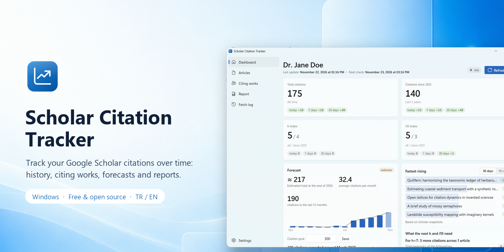
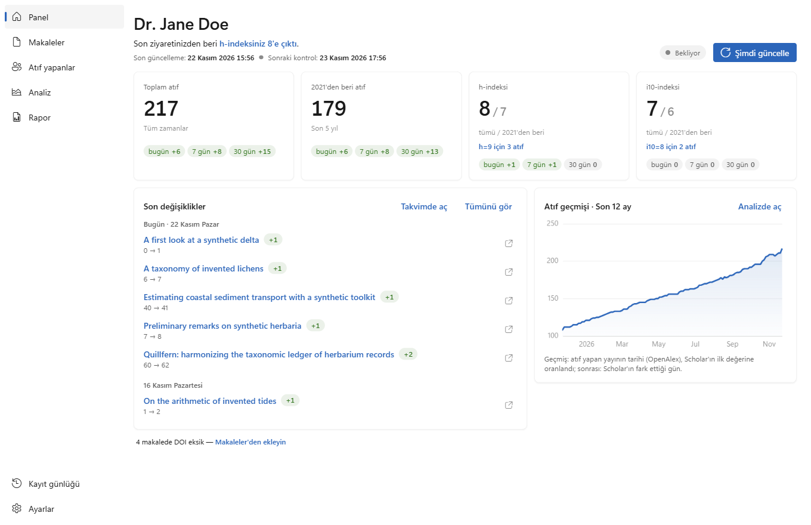
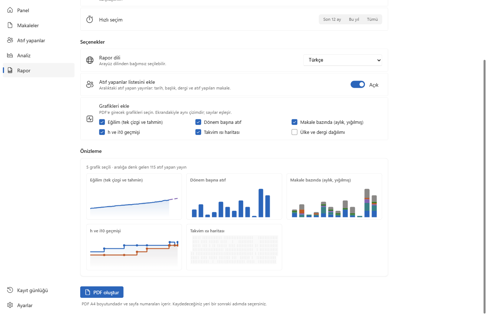

# Scholar Atıf Takip

<p align="center"></p>

<p align="center"><a href="https://github.com/bcankara/scholar-citation-tracker/releases/latest"><b>⬇ Windows için indir</b></a> · <a href="README.md">English</a></p>

Herkese açık bir Google Scholar profilindeki atıf sayılarını zaman içinde izleyen küçük bir Windows masaüstü uygulaması (Rust + Tauri 2). Kişisel kullanım için tasarlandı: kendi profilinizi girersiniz, uygulama sayfayı düşük sıklıkla kontrol eder ve geçmişi bilgisayarınızda saklar.

Arayüz **Türkçe** ve **İngilizce** olarak sunulur. İlk açılışta dil, Windows görüntüleme diline göre seçilir; Ayarlar'dan istediğiniz zaman değiştirebilirsiniz.

## Ekran görüntüleri

<table>
<tr><td width="50%"><br><sub>Panel: toplamlar, tek atıf geçmişi grafiği, son atıflar, tahmin ve en hızlı yükselen makaleler</sub></td><td width="50%"><br><sub>Makaleler: makale geçmişi, değişim geçmişi, eşleşen kayıt ve atıf yapanlar</sub></td></tr>
<tr><td width="50%"><br><sub>Atıf yapanlar: ülke ve dergi dağılımı</sub></td><td width="50%"><br><sub>PDF atıf raporu</sub></td></tr>
</table>

## Ne yapar?

- Profil sayfasını belirli aralıklarla okur (varsayılan 3 saat; 1 ile 24 saat arasında ayarlanabilir) ve toplam atıf, h-indeksi, i10-indeksi, makale bazlı atıflar ile yıllık atıf dağılımını yerel bir SQLite veritabanına kaydeder.
- Panel; bugün / 7 gün / 30 gün değişimlerini, **tek** bir atıf geçmişi grafiğini (birikmiş **Toplam** ile gün, ay ya da yıl bazında **Dönem başına** yeni atıflar arasında geçiş), [son atıfların](#son-atıflar-ve-schoların-atıf-listesi) listesini, tahmini ve en hızlı yükselen makaleleri gösterir. Makaleler sekmesinde her makalenin geçmişi, sayısının her değişimi (artış ya da azalış) ile birlikte açılabilir.
- Atıf sayısı arttığında veya yeni bir makale göründüğünde Windows bildirimi gösterir (ilk kayıtta bildirim yoktur). Scholar bazen atıfları kaldırır (ve sonra geri ekleyebilir): azalışlar tablolarda ve değişim geçmişinde kırmızı gösterilir ama bildirim oluşturmaz. Aynı kontrolde hem artış hem azalış varsa bildirim net değişimi ve artan makaleleri gösterir.
- Başarısız denemeler 5 dakika arayla en fazla 3 kez daha tekrarlanır; her deneme "Kayıt günlüğü" sekmesinde görünür. Google isteği engellerse (HTTP 429 / 403, CAPTCHA sayfası) deneme "Engellendi" olarak kaydedilir ve uygulama bir sonraki döngüyü bekler.
- Pencereyi kapatınca uygulama bildirim alanına (tray) küçülür. Tray menüsünde "Paneli aç", "Şimdi güncelle", "Veri klasörünü aç" ve "Çıkış" bulunur.
- İsteğe bağlı Windows ile başlatma: uygulama gizli olarak, yalnızca tray'de başlar. Varsayılan olarak açıktır, ancak bir profil girdikten sonra kaydedilir; Ayarlar'dan kapatılabilir.
- Özet geçmişi ve makale geçmişi CSV olarak ya da her şey tek bir Excel çalışma kitabı olarak dışa aktarılabilir (CSV UTF-8 BOM'ludur; Excel'de Türkçe karakterler doğru görünür). Sütun başlıkları seçili dile göre yazılır.
- Bir profil girmediğiniz sürece hiçbir şey çekilmez. İlk açılış kartı, profil kimliğini ya da profil adresinin tamamını (`https://scholar.google.com/citations?user=XXXX&hl=en`) ORCID kimliğinizle birlikte (zorunlu, bkz. [Geçmiş veriler](#geçmiş-veriler-isteğe-bağlı)) kabul eder.
- Profili sonradan değiştirirseniz, onayınızın ardından önceki profile ait tüm kayıtlar silinir.
- İsteğe bağlı [geçmiş veriler](#geçmiş-veriler-isteğe-bağlı): OpenAlex'ten, ORCID kimliğiniz üzerinden eşleştirilmiş gün, ay ve yıl düzeyinde geçmiş atıflar.
- Size [atıf yapan yayınların](#atıf-yapanlar-tahmin-raporlar-ve-dışa-aktarma) listesi, tahmin ve hedef öngörüsü, en hızlı yükselen makaleler ile sonraki h / i10 adımı, PDF atıf raporu, Excel dışa aktarma ve haftalık özet bildirimi.
- Daha hızlı, istek sınırına daha az takılan taramalar için isteğe bağlı [API anahtarları](#api-anahtarları-isteğe-bağlı).

## Geçmiş veriler (isteğe bağlı)

Scholar verisi yalnızca uygulamanın kurulduğu günden itibaren toplanır. İsterseniz uygulama geçmişi gün, ay ve yıl düzeyinde ücretsiz kaynaklardan doldurabilir. Bu özellik isteğe bağlıdır ve siz seçene kadar kapalıdır: ilk açılış kurulumundan ve onaylanmış bir profil değişikliğinden sonra bir pencere önerir ("Geçmişi de araştır" / "Bugünden başlat"); **Ayarlar > Geçmiş veriler** bölümünde anahtar, "Şimdi araştır" düğmesi, durum satırı (son çalışma, eşleşen makaleler, atıf kayıtları) ve "Geçmiş verileri sil" düğmesi bulunur.

- **ORCID kimliği (zorunlu).** İlk açılış kartı ve Ayarlar, Scholar profilinin yanında ORCID kimliğinizi ister. `0000-0002-1825-0097` ya da `https://orcid.org/0000-0002-1825-0097` girebilirsiniz; biçim ve ISO 7064 mod 11-2 denetim hanesi doğrulanır, iki alan da geçerli olana kadar "Başla" düğmesi etkinleşmez. Kayıtlı ayarlarda ORCID kimliği yoksa kurulum kartı görünür ve yalnızca onu ister; Scholar takibi bu sırada sürer, yalnızca geçmiş veri araştırması ORCID'e ihtiyaç duyar. ORCID kimliğini sonradan değiştirirseniz eşleşmeler ona bağlı olduğundan geçmiş veriler silinir.
- **Eşleştirme.** ORCID kimliği bir OpenAlex yazarına çözülür. Yazarın yayınları `author.orcid:<kimlik>` ve `authorships.author.id:<yazar kimliği>` süzgeçleriyle toplanır (yayın kimliğine göre birleşim). Her Scholar makalesi bu kümedeki en iyi adaya atanır: başlık benzerliği (kelime bazlı Sørensen–Dice) en az 0,80 ve yayın yılı Scholar'daki yıldan en fazla bir yıl farklı. Bir yayın en çok bir makaleye verilir; bir makale ile onun sonradan eklenen "Version 2" kaydı gibi yakın kopyalar önce benzerlik, sonra yıl ile ayrılır. Bu kümede bulunamayan makaleler, daha sıkı 0,85 eşiğiyle genel OpenAlex başlık aramasına düşer. Eşleşmenin nasıl yapıldığı (`orcid`, `title_search` ya da `manual_doi`; bkz. [Geçmiş eşleşmeyi düzeltme](#geçmiş-eşleşmeyi-düzeltme-doi)) saklanır; hiçbir yerde eşleşmeyen makaleler "eşleşmedi" olarak gösterilir.
- **Kaynak.** Her makale için o makaleye atıf yapan yayınlar OpenAlex'ten istenir. Makaleler sekmesinde açılan satır sayıyı, örneğin "OpenAlex 40", eşleşme yöntemini ve OpenAlex kaydına ve DOI'ye bağlantıları gösterir. Yalnızca OpenAlex kullanılır, çünkü Semantic Scholar ve OpenCitations gerçek makaleler üzerinde karşılaştırıldı ve OpenAlex'te zaten bulunmayan en fazla birkaç atıf yapan yayın ekledi; Semantic Scholar'ın sıkı istek sınırı ise taramaları birkaç kat yavaşlattı. Crossref atıf tarihi vermeyip yalnızca toplam verdiği için (atıf yapanlar listesi yalnızca üyelere açıktır) kullanılmaz.
- **Tarihleme kuralı.** Bir atıf, atıf yapan yayının yayın tarihine göre tarihlenir: kaynakta varsa tam gün, yoksa ay ya da yıl. Yalnızca yılı olan kayıtlar Yıl görünümünde yer alır, Gün / Ay görünümlerinde yer almaz (grafik kaç kayıt olduğunu belirtir).
- **Sayılar Scholar'dan farklıdır.** Kaynaklar Google Scholar'dan farklı yayınları dizinler; bu yüzden toplamlar tutmaz. Hiçbir şey ölçeklenmez ya da uzlaştırılmaz ve her grafik kaynağını belirtir. Geçmiş grafiğinde Yıl görünümü Scholar'ın kendi yıllık dağılımını kullanır; Gün ve Ay görünümleri geçmiş veri serisini kullanır ve seri yokken devre dışıdır.
- **Çalışma.** İlk Scholar kontrolünden sonra (veri varsa hemen) arka planda, aynı anda tek çalıştırma olarak çalışır; Scholar zamanlayıcısını engellemez ve etkilemez; hatalar ayarlar kartında görünür. Sonraki bir kontrolde yeni makale görülürse otomatik araştırılır. Yeniden çalıştırma kayıtları ekleyip çoğaltmak yerine değiştirir. Anahtarsız, OpenAlex yaklaşık saniyede bir (HTTP 429'da geri çekilmeyle) çağrılır; anahtarla yaklaşık 0,4 sn arayla. Uzun bir makale listesi yine de zaman alır; bu yüzden çalıştırma bir [tarama panelinde](#tarama-paneli) gösterilir ve durdurulabilir.
- **Gizlilik.** İsteklerde genel bir User-Agent (`scholar-citation-tracker/<sürüm> (+depo adresi)`) bulunur, e-posta adresi yoktur. Makale başlıkları, DOI'ler ve ORCID kimliğiniz OpenAlex'e gönderilir; bu özellik için Google'a hiçbir şey gönderilmez.

## Tarama paneli

Geçmiş veri taraması çalışırken sağ kenardan bir panel kayarak açılır (**Geçmiş veri taraması**; X ile kapatılır, üst çubuktaki "Geçmiş taranıyor 3/11" etiketinden ya da Ayarlar'dan yeniden açılır). Taramayı kendiniz başlattığınızda (ilk açılış seçimi, "Şimdi araştır", DOI düzeltmesi) kendiliğinden açılır; günlük otomatik yenileme yalnızca etiketi gösterir.

- Genel ilerleme çubuğu: "Makale 3 / 11", geçen süre ve tahmini kalan süre.
- Şu anki adım düz bir dille: "OpenAlex'ten atıf yapanlar alınıyor — sayfa 2, 87 kayıt" ya da bir sunucu uygulamadan yavaşlamasını istediğinde (HTTP 429 / 503) canlı geri sayımla "OpenAlex hız sınırı: 12 sn bekleniyor".
- Taramadaki her makale, durumu (sırada, çalışıyor, tamam, eşleşmedi, hata) ve sonucuyla, örneğin "OpenAlex 40".
- Son 30 olayı zamanlarıyla gösteren açılır **Ayrıntılar** günlüğü.
- **Durdur**, geçerli istekten sonra taramayı bitirir; o ana kadar kaydedilenler kalır, çalıştırma "durduruldu" olarak kaydedilir.
- Tarama bitince bir özet (eşleşen X / Y, kayıt sayısı, yeni olanlar, süre) siz paneli kapatana kadar kalır; eşleşmeyen ya da DOI'si olmayan makale sayısı da orada yer alır.

Dar pencerelerde panel tüm genişliği kaplar.

## Son atıflar ve Scholar'ın atıf listesi

Panelin **Son atıflar** kartı iki kaynağı tek bir listede, yeniden eskiye birleştirir (son on kayıt; "Tümünü gör" Atıf yapanlar sekmesini açar):

- **Scholar'da görülen değişimler.** Bir makalenin sayısı kayıtlı iki ardışık anlık görüntü arasında farklıysa "21 Kas — <makale> +2" gibi bir satır "Google Scholar" rozetiyle listelenir; azalış, "Scholar'da azaldı" etiketiyle kırmızı gösterilir. İlk anlık görüntünün öncesinde bir şey olmadığı için hiçbir zaman sayılmaz.
- Geçmiş araştırmanın (OpenAlex) bulduğu **atıf yapan yayınlar**; başlık, dergi, atıf yapılan makale ve kaynak rozetiyle.

Her Scholar satırında ve Makaleler sekmesindeki her makalede **Scholar'da gör** bulunur. Makalenin atıf listesini Scholar'da tarihe göre sıralı olarak **varsayılan tarayıcınızda** açar. Uygulama bu sayfayı kendisi okumaz: Scholar'ın arama sayfaları CAPTCHA ile korunur ve uygulama yalnızca herkese açık profil sayfanızı düşük sıklıkla okur. Bağlantı, profil sayfasının her makale için zaten içerdiği `cites=` kimliklerinden oluşturulur.

## Atıf yapanlar, tahmin, raporlar ve dışa aktarma

- **Atıf yapanlar (Atıf yapanlar sekmesi).** Geçmiş veriler açıkken, tarama atıf yapan her yayın için başlığını, yayın tarihini, dergisini (yayın yerini), DOI'sini, bağlantısını, yazarlarını, yazarların kurumlarının ülke kodlarını ve kayıt kimliğini saklar. Sekme hepsini listeler (tarih, DOI / OpenAlex sayfasına bağlı başlık, dergi, hangi makalelerinize atıf yaptığı); arama kutusu, makale süzgeci ve tarihe göre sıralama vardır. Makaleler sekmesinde bir makalenin açılan satırı da o makaleye atıf yapanları listeler. İki grafik, atıf yapan yayınların ilk 10 ülkesini ve ilk 10 dergisini gösterir (bir yayın, birden çok makalenize atıf yapsa da bir kez sayılır); bir alt yazı kaç yayında ülke bilgisinin olmadığını söyler. Atıf yapanların yıllara göre dağılımı zaten panelteki geçmiş grafiğinin içindedir.
- **Yeni atıf yapanlar.** Geçmiş veriler açıkken yaklaşık günde bir kez hafif bir yenileme çalışır (en erken açılıştan on dakika sonra, sonra her 24 saatte bir). Yalnızca eşleşmiş makalelerin atıf yapan listelerini, kayıtlı OpenAlex kimliğiyle, aşağıda anlatılan istek aralıklarıyla ve yeniden eşleştirme yapmadan okur. Daha önce kayıtlı olmayan atıf yapan yayınlar bulursa (ilk taramada asla) bir Windows bildirimi en fazla ikisini adıyla belirtir. "Bildirimler" ayarına uyar.
- **Tahmin (Panel).** Son 12 ayın aylık atıf sayısı (Scholar anlık görüntülerinden, yoksa geçmiş verilerden), yıl sonu için tahmini toplam ve karta yazdığınız bir hedef için "N atıfa tahminen <ay yıl>". Oran doğrusaldır (son üç tam ayın ortalaması; yoksa içinde bulunulan ay; yoksa kayıtlı anlık görüntülerin süresi) ve her zaman tahmin olarak etiketlenir. Hedef yerel veritabanında saklanır.
- **En hızlı yükselenler (Panel).** Son 30 ya da 90 günde en çok atıf kazanan beş makale (Scholar anlık görüntüleri; anlık görüntüler o kadar geriye gitmiyorsa geçmiş veriler; kayıtlı geçmiş dönemden kısaysa bir not belirtir) ve sonraki h-indeksi ile i10-indeksi için gerekenler, örneğin "h=5 için: 2 makaleye toplam 3 atıf daha"; en yakın makaleler listelenir.
- **PDF rapor (Rapor sekmesi).** Bir tarih aralığı, rapor dili (Türkçe ya da İngilizce) ve atıf yapanlar listesi ile grafiklerin eklenip eklenmeyeceği seçilir, ardından **PDF oluştur**. Sayfa numaralı A4 PDF; kapak sayfası (profil adı, ORCID kimliği, aralık, oluşturma tarihi), özet göstergeler (toplam, başlangıç yılından beri, h, i10, aralıktaki değişim), makale tablosu (aralık sonunda atıf, aralıkta kazanılan), grafikler (zaman içinde toplam, yıllara göre), isteğe bağlı olarak aralıktaki atıf yapanlar (tarih, başlık, dergi, atıf yapılan makale) ve kaynaklar-ve-yöntem notunu içerir. Rapor bir HTML sayfasıdır (`ui/report.html`); gizli bir pencerede çizilir ve WebView2'nin kendi `PrintToPdf` işleviyle PDF'e yazdırılır, bu yüzden Türkçe karakterler sistem yazı tipinden gelir.
- **Excel'e aktarma (Ayarlar > Dışa aktar).** Özet (anlık görüntü geçmişi), Makaleler (bugün / 7 / 30 günlük değişimlerle en son değerler), Makale geçmişi (uzun biçim), Atıf yapanlar ve Yıllık sayfalarını içeren tek bir .xlsx. Başlık satırları kalın ve renkli, sabitlenmiş ve süzülebilir; tarihler gerçek Excel tarihleridir; sayfa adları ve başlıklar arayüz diline göredir. İki CSV dışa aktarması da durur.
- **Haftalık özet.** Pazartesi günü saat 09:00'da ya da sonrasındaki ilk açılışta (yerel saat), ISO haftasında bir kez, "Bu hafta +N atıf; en çok: <makale> (+k)" bildirimi gösterilir. Haftada veri yoksa atlanır. Anahtar: **Ayarlar > Haftalık özet bildirimi** (varsayılan açık; "Bildirimler" de açık olmalı).

## API anahtarları (isteğe bağlı)

**Ayarlar > API anahtarları (isteğe bağlı)** ücretsiz bir OpenAlex anahtarı girmenizi sağlar. Uygulama anahtarsız da çalışır.

- **OpenAlex.** Anahtar zorunlu değil. Anahtarsız kullanımda günlük bütçe IP adresine göre paylaşılır (üniversite ağlarında hızla tükenebilir) ve sınır saniyede 10 istektir; ücretsiz anahtar günlük bütçeyi 10 kat artırır ve sınırı saniyede 30 isteğe çıkarır. Anahtarı [openalex.org](https://openalex.org) adresinden alın (hesap açıp Ayarlar > API key bölümünden kopyalayın) ya da **E-postayla ücretsiz anahtar iste** düğmesine basın: e-posta adresinizi yazarsınız, uygulama `POST https://api.openalex.org/api-keys` çağrısını yapar; OpenAlex anahtarı (durum `pending_activation`) yanıtlar, uygulama onu saklar ve siz e-postanızdaki etkinleştirme bağlantısına tıklarsınız. Adres yalnızca o tıklamada gönderilir ve hiçbir yerde saklanmaz. [OpenAlex istek sınırları ve kimlik doğrulama](https://docs.openalex.org/how-to-use-the-api/rate-limits-and-authentication) sayfasına bakın. Anahtar URL'de değil, `Authorization: Bearer <anahtar>` üstbilgisiyle gönderilir.
- **Saklama ve güvenlik.** Anahtarlar `settings.json`'a ya da veritabanına değil, Windows Kimlik Bilgileri Yöneticisi'ne (hizmet adı `scholar-citation-tracker`) yazılır. Günlüklere, çalıştırma iletilerine ve hata metinlerine asla girmez (anahtara benzeyen her şey maskelenir). **Sına** düğmesi ucuz bir istek yapar ve anahtarın geçerli olup olmadığını söyler. OpenAlex kayıtlı anahtarı reddederse (HTTP 401 / 403) uygulama bir kez uyarır ve anahtarsız devam eder.

## Veriler nerede?

- Veritabanı: `Belgelerim\ScholarTakip\scholar_takip.db` (SQLite, WAL kipi). Klasör Ayarlar'dan değiştirilebilir; yeni klasörde veritabanı yoksa mevcut olan oraya kopyalanır, varsa o kullanılır.
- Ayarlar: `%APPDATA%\io.github.bcankara.scholarcitationtracker\settings.json`
- API anahtarları (girerseniz): Windows Kimlik Bilgileri Yöneticisi, hizmet adı `scholar-citation-tracker`.

## Geçmiş eşleşmeyi düzeltme (DOI)

Makaleler sekmesinde bir makaleyi açın ve geçmiş veri sütununa bakın. Yanlış ya da eksik eşleşmeyi üç eylem düzeltir:

- **DOI'yi düzelt.** Makalenin doğru DOI'sini `10.xxxx/...`, `doi:10.xxxx/...` ya da `https://doi.org/10.xxxx/...` biçiminde girin. Makale yalnızca bu DOI ile aranır (`https://api.openalex.org/works/doi:<doi>`); başlık eşleştirmesi yapılmaz, yöntem "elle DOI" olarak gösterilir. OpenAlex DOI'yi bilmiyorsa makale, DOI ile birlikte "eşleşmedi" olarak gösterilir.
- **Bu değil.** Şu anki eşleşmeyi bu makale için dışlar ve makaleyi yeniden arar; reddedilen OpenAlex kaydı bu makaleye bir daha önerilmez.
- **Otomatik eşleştirmeye dön.** Elle girilen DOI'yi ve reddedilen kayıtları siler, makaleyi yeniden otomatik eşleştirir.

Bunlardan birini kaydetmek, yalnızca o makale için aramayı hemen yeniden çalıştırır. Düzeltmeler yerel veritabanında saklanır; sonraki çalıştırmalardan ve "Geçmiş verileri sil" işleminden etkilenmez (hesaplanmış veri değil, sizin kararınızdır); yalnızca Scholar profilini değiştirdiğinizde, tüm kayıtlarla birlikte silinir.

## Makalelerin DOI'si

Makaleler sekmesi, DOI biliniyorsa (önce elle girilen DOI, yoksa eşleşen OpenAlex kaydının DOI'si) her başlığın altında bir **DOI** etiketi, bilinmiyorsa bir **DOI ekle** düğmesi gösterir. Düğme, satırı açmadan "DOI'yi düzelt" ile aynı pencereyi açar. Bazı makalelerin DOI'si eksikse, tablonun üstündeki bilgi çubuğu kaç tane olduğunu söyler ve listeyi onlara süzebilir (oturum boyunca kapatılabilir); panel ve tarama özeti bu süzülmüş listeye bağlantı verir. DOI, geçmiş verilerin ve atıf yapanların doğru kayda eşleşmesini sağlar.

## Sağlık uyarısı

Scholar 2 gün üst üste başarıyla okunamazsa (bu sürede deneme yapıldığı hâlde son başarılı okuma en az 48 saat önceyse) uygulama bir Windows bildirimi ("Scholar 2 gündür okunamıyor — Kayıt günlüğüne bakın") ve Panel'de bir sonraki başarılı okumaya kadar bir uyarı çubuğu gösterir. Bildirim olay başına bir kez, hiçbir zaman 24 saatte birden fazla gösterilmez ve "Bildirimler" ayarına uyar. Sayfa gelip de makale listesi okunamıyorsa da aynısı geçerlidir: profil atıf gösterip hiç makale göstermiyorsa ya da toplam atıf düşmediği hâlde makale sayısı yarıdan fazla azalırsa deneme Kayıt günlüğünde çözümleme hatası olarak kaydedilir ve anlık görüntü saklanmaz ("makale listesi okunamadı — Scholar sayfa yapısı değişmiş olabilir").

## Kurulum

Kurulum dosyasını (`Scholar.Citation.Tracker_<sürüm>_x64-setup.exe`) **Releases** sayfasından indirip çalıştırın. Kurulum yalnızca geçerli kullanıcı için yapılır ve yönetici yetkisi gerektirmez. Kurulum sihirbazı Türkçe ve İngilizce sunulur. Uygulama Microsoft WebView2 çalışma zamanını gerektirir; güncel Windows 10 / 11 sürümlerinde zaten bulunur.

Kurulum dosyasını Dosya Gezgini'nde çift tıklayarak çalıştırın. Bir korumalı (sandbox) ya da paketlenmiş uygulamanın içinden (örneğin bir sohbet ya da mağaza uygulamasının dosya önizlemesinden) çalıştırmak Windows'un kurulumu sanallaştırmasına yol açabilir; bu durumda uygulama Yüklü uygulamalar listesinde görünmez.

**Kurulum dosyası kod imzalı değildir**; bu yüzden Windows SmartScreen ilk seferde *"Windows bilgisayarınızı korudu"* uyarısını gösterir. **Ek bilgi**'ye, ardından **Yine de çalıştır**'a tıklayın.

Neden: kod imzalama sertifikası her yıl ücretlidir ve bu, sertifikası olmayan küçük, kişisel bir açık kaynak projedir. Bunun yerine kurulum dosyası, bu depodaki kaynaktan GitHub Actions ile açıkça derlenir (bkz. `.github/workflows/release.yml`) ve indirdiğiniz dosyanın o iş akışının derlediği dosya olduğunu doğrulayabilirsiniz:

1. **SHA-256.** Her sürümde bir `SHA256SUMS.txt` bulunur. PowerShell'de indirdiğiniz dosyanın özetiyle karşılaştırın:

   ```
   Get-FileHash .\Scholar.Citation.Tracker_<sürüm>_x64-setup.exe -Algorithm SHA256
   ```

2. **Derleme kaynağı kanıtı (provenance).** [GitHub CLI](https://cli.github.com/) kuruluyken:

   ```
   gh attestation verify .\Scholar.Citation.Tracker_<sürüm>_x64-setup.exe --repo bcankara/scholar-citation-tracker
   ```

   Bu, dosyanın tam olarak bu deponun GitHub Actions iş akışı tarafından derlendiğini doğrular.

### Güncellemeler

İlk kurulumdan sonra güncellemeler uygulamanın içinden kurulur. Açılıştan yaklaşık bir dakika sonra ve sonra günde bir kez (anahtar: **Ayarlar > Güncellemeleri otomatik denetle**) uygulama daha yeni bir sürüm arar. Varsa bir çubuk "Yeni sürüm X hazır" iletisini sürüm notlarıyla ve **Şimdi güncelle** düğmesiyle gösterir: kurulum dosyasını ilerleme göstergesiyle indirir, kurar ve uygulamayı yeniden başlatır. **Ayarlar > Hakkında** sürümü, GitHub bağlantısını ve lisansı gösterir; sonucunu her zaman bildiren bir **Güncellemeleri denetle** düğmesi vardır (arka plandaki denetimin hataları sessizdir). Güncellemeler projenin güncelleme anahtarıyla imzalanır; anahtar uygulamanın içindedir ve herhangi bir şey kurulmadan önce denetlenir, bu yüzden bu yolda SmartScreen uyarısı yeniden görünmez.

## Kaldırma

**Ayarlar → Uygulamalar → Yüklü uygulamalar → Scholar Atıf Takip → Kaldır** yolunu izleyin ya da Başlat menüsündeki girdiye sağ tıklayıp **Kaldır**'ı seçin; uygulamadaki **Ayarlar → Hakkında → Kaldır…** düğmesi o Windows sayfasını açar. Kaldırıcı uygulama verilerinin silinmesini önerir. Atıf veritabanı, o klasörü silmediğiniz sürece (ya da Ayarlar'da veri klasörünü değiştirmediyseniz) `Documents\ScholarTakip` içinde kalır; ayarlar `%APPDATA%\io.github.bcankara.scholarcitationtracker` içindedir.

## Kaynaktan derleme

Gereksinimler:

- Rust (kararlı sürüm, MSVC araç zinciri)
- Visual Studio C++ Build Tools (C++ ile masaüstü geliştirme)
- Microsoft WebView2 çalışma zamanı
- Tauri CLI: `cargo install tauri-cli --version "^2"`

Node.js ve npm gerekmez; arayüz `ui/` klasöründeki düz HTML/CSS/JS'tir.

```
cd src-tauri
cargo test
cargo tauri build
```

Güncelleme çıktıları etkin olduğundan `cargo tauri build` bir imza anahtarı ister: `TAURI_SIGNING_PRIVATE_KEY_PATH` (`cargo tauri signer generate` ile üretilmiş anahtar dosyasının yolu) ve `TAURI_SIGNING_PRIVATE_KEY_PASSWORD` ortam değişkenlerini ayarlayın; eşleşen açık anahtar `tauri.conf.json` içindeki `plugins.updater.pubkey` alanına yazılır. Kurulum dosyası ve `.sig` dosyası `src-tauri\target\release\bundle\nsis\` altında oluşur.

Canlı sayfanın hâlâ çözümlenebildiğini denemek için (tek istek) `src-tauri` klasöründe `cargo run -- --once <profil kimliği veya profil adresi>` komutunu çalıştırın; hata ayıklama derlemesi sonucu konsola yazar.

Testler, test kodunun içinde yer alan küçük, elle yazılmış bir profil sayfası kullanır. Gerçek bir profil sayfasının kayıtlı kopyasını `src-tauri/tests/fixtures/profile.html` yoluna koyarsanız ek tutarlılık kontrolleri de çalışır; dosya yoksa bu kontroller atlanır. `fixtures` klasörü git tarafından yok sayılır.

## Sürüm yayımlama (bakımcılar)

`src-tauri/tauri.conf.json` içindeki sürümle eşleşen bir `vX.Y.Z` etiketi gönderildiğinde GitHub Actions'ta `.github/workflows/release.yml` başlar. Testleri çalıştırır, NSIS kurulum dosyasını derler (`TAURI_SIGNING_PRIVATE_KEY` / `TAURI_SIGNING_PRIVATE_KEY_PASSWORD` gizli anahtarlarındaki güncelleme anahtarıyla imzalanır) ve kurulum dosyası, `.sig`, `latest.json` ve `SHA256SUMS.txt` içeren bir **taslak (draft)** sürüm oluşturur; derleme kaynağı kanıtı da eklenir. Taslağı gözden geçirip yayımlayın. Uygulama içi güncelleyici `https://github.com/bcankara/scholar-citation-tracker/releases/latest/download/latest.json` adresini okur; bu adres yalnızca sürüm **yayımlandıktan** sonra vardır (taslak ona görünmez). İş akışının elle çalıştırılması (*Run workflow*) aynı dosyaları iş akışı çıktısı olarak üretir ve sürüm oluşturmaz.

## Sorumluluk reddi

Bu, resmî olmayan ve bağımsız bir projedir; Google ile bağlantılı değildir, Google tarafından desteklenmez veya onaylanmamıştır. Herkese açık profil sayfasını düşük bir istek sıklığıyla (varsayılan olarak 3 saatte bir) okur ve herhangi bir özel API kullanmaz. Google Scholar'ın resmî bir API'si yoktur; sayfa yapısı veya kullanım koşulları değişebilir ve bu durum uygulamayı her an bozabilir. Kullanımınızın Google'ın hizmet şartlarına uygun olmasından siz sorumlusunuz. Uygulama, kendi profilinizi izlemek için kişisel kullanıma yöneliktir; toplu veya yüksek sıklıklı veri çekme için kullanmayın.

## Katkılar

Uygulama simgesi, Microsoft'un Fluent UI System Icons (MIT Lisansı) çalışmasını temel alır.

## Lisans

[MIT](LICENSE)
